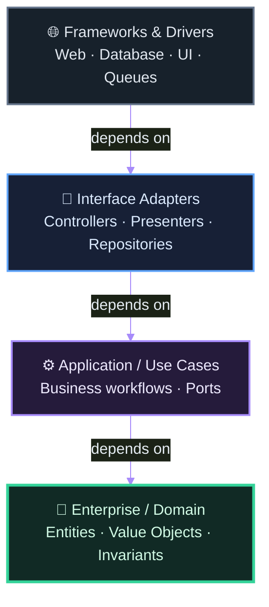
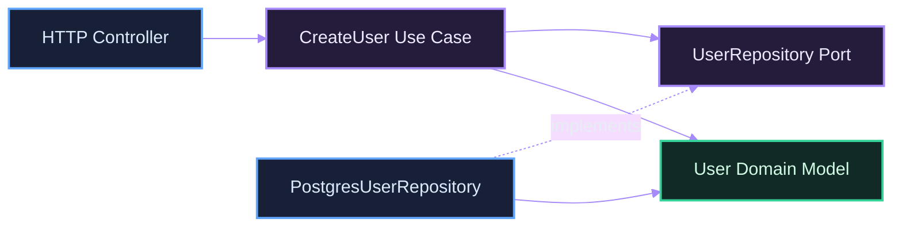

<div align="center">

# 🏛️ Clean Architecture

**Keep business rules at the center. Keep implementation details at the edges.**

A visual, practical guide to building software that stays maintainable as technology changes.


[Run the .NET demo](#-run-the-working-net-solution) • [Overview](#-overview) • [Layers](#-the-four-layers) • [Dependency Rule](#-the-dependency-rule) • [Example](#-putting-it-together) • [Trade-offs](#-trade-offs)

</div>

---

## 🚀 Run the working .NET solution

This repository now includes a **real, multi-project C# / .NET 8 example**. Explore the source, execute the API, run the tests, and inspect the dependency boundaries yourself.

[](https://dotnet.microsoft.com/download/dotnet/8.0)
[](./src)
[](https://github.com/1x4x/30-clean-architecture/archive/refs/heads/main.zip)

**[⬇ Download the complete .NET solution as ZIP](https://github.com/1x4x/30-clean-architecture/archive/refs/heads/main.zip)** · **[Open the Visual Studio solution](./CleanArchitecture.sln)** · **[Read the demo instructions](./demo/README.md)**

### What is included?

| Project | Responsibility | Depends on |
| --- | --- | --- |
| [Domain](./src/CleanArchitecture.Domain) | `Order`, `OrderItem`, validation, state transitions | No application projects |
| [Application](./src/CleanArchitecture.Application) | `CreateOrder`, `ConfirmOrder`, `IOrderRepository` port | Domain |
| [Infrastructure](./src/CleanArchitecture.Infrastructure) | In-memory repository adapter | Application, transitively Domain |
| [API](./src/CleanArchitecture.Api) | ASP.NET Core minimal API and dependency injection | Application, Infrastructure |
| [Tests](./tests/CleanArchitecture.Tests) | Domain, use-case, and assembly dependency checks | Tested projects |

### Start the API

Install the **.NET 8 SDK** (or a newer SDK capable of targeting .NET 8), then run from the repository root:

```bash
dotnet restore CleanArchitecture.sln
dotnet test CleanArchitecture.sln
dotnet run --project src/CleanArchitecture.Api --urls http://localhost:5080
```

In another terminal, create an order:

```bash
curl -i -X POST http://localhost:5080/orders \
  -H "Content-Type: application/json" \
  -d '{"sku":"BOOK","unitPrice":25,"quantity":2}'
```

Copy the `id` from the JSON response, then confirm and inspect the order:

```bash
curl -i -X POST http://localhost:5080/orders/YOUR_ORDER_ID/confirm
curl http://localhost:5080/orders/YOUR_ORDER_ID
```

You should see a confirmed order with a total of **50**. You can also try invalid prices or quantities and see the domain rule reject them.

### Prove the separation

Run `dotnet test CleanArchitecture.sln`. The tests exercise domain invariants and application use cases **without starting the web server or connecting to a database**. They also inspect assembly references to check that Domain and Application do not reference outer projects or ASP.NET Core/EF Core.

**What to try:** Replace `InMemoryOrderRepository` with a database-backed implementation of `IOrderRepository`. The `Order`, `CreateOrder`, and `ConfirmOrder` code should remain unchanged. This is the dependency rule in action.

> **Demo scope:** The in-memory repository loses data on restart and is not production-safe for concurrent updates. The solution demonstrates architecture, not a complete commerce platform. It has not been executed in the authoring environment; verify with `dotnet test` locally.

---

## 🌌 Overview

**Clean Architecture** organizes software around the business capabilities it provides rather than the frameworks, databases, or transport protocols it uses.

At the center are **domain rules** and **application use cases**. Infrastructure—such as HTTP, SQL, queues, and UI frameworks—belongs at the edges. Boundaries make those details replaceable.

> **The guiding rule:** Source-code dependencies point **inward**, toward business policy.

| Goal | How Clean Architecture helps |
| --- | --- |
| 🧠 Business focus | Core logic models business concepts rather than framework APIs. |
| 🔄 Changeability | Swap a database or delivery mechanism without rewriting use cases. |
| 🧪 Testability | Test application behavior using in-memory fakes. |
| 🔌 Explicit boundaries | Interfaces (ports) specify what the core needs from the outside world. |
| 🧭 Clear ownership | Each layer has a distinct responsibility. |

## 🎨 Architecture map

The Mermaid diagram uses a dark palette inspired by GitHub's dark theme. **Arrows represent source-code dependencies**, not necessarily runtime execution order.



> The diagram shows a simplified hierarchy of conceptual layers. Your source tree does not need to mirror the four rings exactly. **The direction of dependencies matters more than folder names.**

## 🧱 The four layers

### 01 · 💎 Entities — domain

The **innermost layer** represents durable business concepts and rules: entities, value objects, and invariants. It should not import HTTP libraries, ORMs, or database clients.

**Example:** An order must contain at least one item before it can be placed.

### 02 · ⚙️ Use cases — application

Use cases coordinate actions the system can perform: `PlaceOrder`, `RegisterUser`, or `CancelSubscription`.

They invoke domain behavior and depend on **abstract ports** for services such as persistence. A use case should not know whether the order is stored in PostgreSQL, Redis, or memory.

### 03 · 🔌 Interface adapters

Adapters translate between external representations and the application's boundary:

- Controllers turn HTTP requests into use-case inputs.
- Presenters turn use-case outputs into responses.
- Repository adapters implement persistence ports using a real database.

Their job is **translation**, not the ownership of core business rules.

### 04 · 🌐 Frameworks & drivers

These are concrete delivery and infrastructure details: routers, web servers, database engines, third-party SDKs, messaging tools, and UI frameworks.

> **Frameworks are tools, not the foundation of your business logic.**

## 🧭 The dependency rule

**Code in an inner layer must not depend on code in an outer layer.**

For example, an application use case can define a `UserRepository` interface, while a database adapter implements it. This is **dependency inversion**: the abstraction lives close to the policy that needs it.



The **runtime request flow** can travel from a controller to a use case to a repository implementation and then to a database. That does **not** mean the application imports the repository implementation: the implementation is supplied at startup by composition or dependency injection.

## 💻 Putting it together

Below is a deliberately small **TypeScript example**, for illustration rather than a claim about this repository's implementation. It registers a user without coupling the use case to a database or web framework.

**1. Domain model** — `src/domain/user.ts`

```ts
export type User = {
  id: string;
  email: string;
};
```

**2. Application port and use case** — `src/application/register-user.ts`

```ts
import type { User } from "../domain/user";

export interface UserRepository {
  findByEmail(email: string): Promise<User | null>;
  save(user: User): Promise<void>;
}

export interface IdGenerator {
  generate(): string;
}

export class RegisterUser {
  constructor(
    private readonly users: UserRepository,
    private readonly ids: IdGenerator
  ) {}

  async execute(email: string): Promise<User> {
    const normalized = email.trim().toLowerCase();

    if (!normalized.includes("@")) {
      throw new Error("Invalid email");
    }

    if (await this.users.findByEmail(normalized)) {
      throw new Error("Email already registered");
    }

    const user = { id: this.ids.generate(), email: normalized };
    await this.users.save(user);
    return user;
  }
}
```

**3. Infrastructure adapter** — `src/infrastructure/in-memory-user-repository.ts`

```ts
import type { User } from "../domain/user";
import type { UserRepository } from "../application/register-user";

export class InMemoryUserRepository implements UserRepository {
  private readonly items = new Map<string, User>();

  async findByEmail(email: string): Promise<User | null> {
    return [...this.items.values()].find(u => u.email === email) ?? null;
  }

  async save(user: User): Promise<void> {
    this.items.set(user.id, user);
  }
}
```

**4. Composition root** — `src/main.ts`

```ts
import { randomUUID } from "node:crypto";
import { RegisterUser } from "./application/register-user";
import { InMemoryUserRepository } from "./infrastructure/in-memory-user-repository";

const registerUser = new RegisterUser(
  new InMemoryUserRepository(),
  { generate: randomUUID }
);

const newUser = await registerUser.execute("hello@example.com");
console.log(newUser);
```

The use case can now be tested without HTTP or SQL. A production adapter can replace the in-memory repository at the composition root without changing `RegisterUser`.

> For a real production system, use a robust email validator and handle concurrent registration with a database uniqueness constraint. The sample intentionally focuses on **dependency direction**.

## 📂 Example project structure

```text
src/
├── domain/
│   ├── user.ts                     # Business model
│   └── ...                         # Domain policies
├── application/
│   ├── register-user.ts            # Use case + required ports
│   └── ...                         # Application workflows
├── adapters/
│   ├── http/                       # Request/response translation
│   └── persistence/                # SQL/ORM implementations
├── infrastructure/
│   └── ...                         # External integrations
└── main.ts                         # Dependency wiring
```

This structure is a **suggestion**, not an existing repository inventory. Organize by feature or bounded context when the application becomes large enough to benefit from it.

## 🧪 Testing strategy

| Level | What to test | Usually requires |
| --- | --- | --- |
| **Domain** | Business invariants and decisions | Plain objects |
| **Application** | Use-case behavior, errors, orchestration | Fakes / mocks of ports |
| **Adapters** | Serialization, database queries, SDK mapping | Integration test infrastructure |
| **End-to-end** | Critical flows across the deployed system | Running services |

A healthy test suite tends to put most fast tests near domain and application rules, while using integration tests to verify that real adapters honor their contracts.

## ⚖️ Trade-offs

| ✅ Benefits | ⚠️ Costs |
| --- | --- |
| Business logic survives framework changes | More interfaces and wiring |
| Dependencies are deliberate and visible | Additional abstraction can slow a tiny project |
| Easy-to-isolate use cases | Poorly designed boundaries can add boilerplate |
| Infrastructure is replaceable | Requires discipline about import direction |

**Use Clean Architecture when** business rules are substantial, the application will evolve, multiple integrations are expected, or independent testing is important.

**Keep it simpler when** building a small one-off script, a throwaway prototype, or a very basic CRUD service where extra layering brings little value. It is a design tool—not a requirement for every project.

## 🚫 Common pitfalls

- **Layering by folder name only:** Having a `domain/` directory means little if it imports ORM models.
- **Putting business rules in controllers:** Transport concerns should not decide domain behavior.
- **Creating interfaces for everything:** Introduce ports where they protect a meaningful boundary.
- **Leaking framework types:** Avoid passing framework request objects into your use cases.
- **Confusing call flow with import flow:** Runtime calls can reach outward through ports; source-code dependencies still point inward.

## 📚 Further reading

- [Robert C. Martin — The Clean Architecture](https://blog.cleancoder.com/uncle-bob/2012/08/13/the-clean-architecture.html)
- [Martin Fowler — Inversion of Control](https://martinfowler.com/bliki/InversionOfControl.html)
- [Martin Fowler — Repository](https://martinfowler.com/eaaCatalog/repository.html)

---

<div align="center">

### 💜 Keep the core clean.

**Domain first · Dependencies inward · Details at the edges**

Made for developers who want software that stays understandable.

</div>
